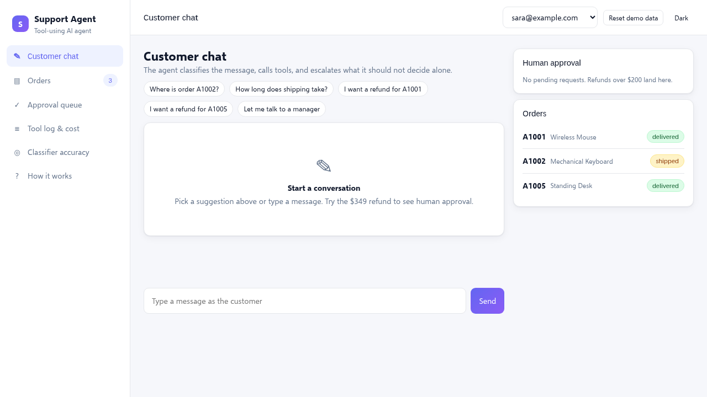
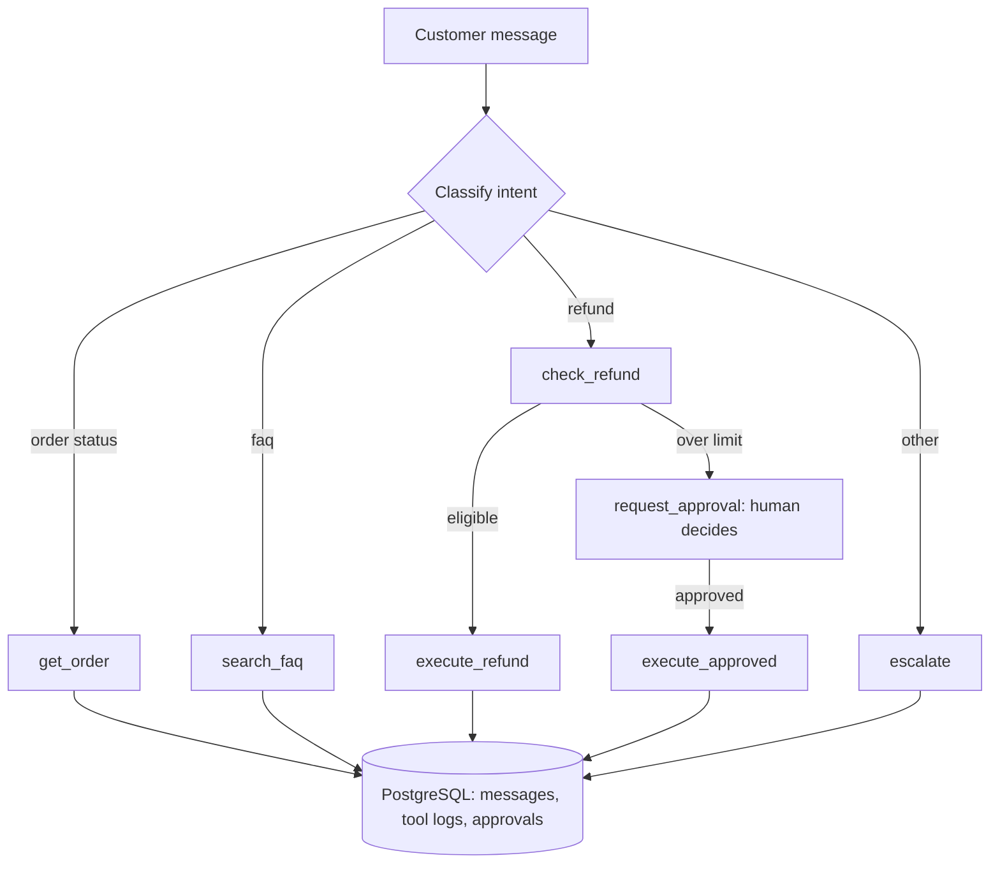

# AI Customer Support Agent (LangGraph, tool calling, human approval)

[](https://github.com/ZeyadMohamed00/ai-support-agent/actions/workflows/ci.yml)

A support agent for an online shop: answers FAQs, looks up orders, issues refunds under business rules, asks a human to approve large refunds, and escalates. FastAPI + LangGraph + PostgreSQL + React/TypeScript.

**Live app (free tier):** https://support-web-green.vercel.app  (click a suggestion, e.g. "I want a refund for A1005", then Approve in the queue)
API docs: https://support-api-liard.vercel.app/docs



Pages: Customer chat, Orders, Approval queue (refunds over $200 need a human), Tool log and cost, Classifier accuracy, How it works, with dark mode.

## System overview


**Tech stack:** LangGraph, FastAPI, PostgreSQL, React, TypeScript, Pytest, Docker.

## Architecture
```
classify -> order_status | faq | greeting | escalate
         -> check_refund -> needs human?  -> request_approval -> END  (human decides via API)
                         -> eligible?     -> execute_refund  -> END
resume (after approval) -> execute_approved -> END
```
- `support/graph.py`: the LangGraph state machine above (conditional entry point lets an approval re-enter the graph).
- `support/tools.py`: tools that enforce authorization and business rules, with retry + audit logging.
- `support/classify.py`: intent classifier (rules by default; LLM classifier written but not run) and cost tracking.
- `support/db.py`: PostgreSQL models: orders, conversations, messages, tool logs, approvals, LLM usage.
- Each visitor gets their own private copy of the synthetic orders (keyed by a browser id), so demos never collide.

## What is implemented
Tool calling (get_order, search_faq, check_refund, execute_refund, escalate), multi-step workflow, **human approval** (refund over $200 stops at `request_approval`, nothing happens until a human approves; a rejected request never refunds), **retry with exponential backoff** (3 tries, then a graceful message, all logged), conversation history in Postgres, per-call tool log with attempts and latency, LLM **cost tracking** table and endpoint, and a classification accuracy evaluation.

## Honest status
- **The live app classifies with Gemini** (`gemini-3.1-flash-lite`, free tier, `CLASSIFIER=llm` + `GEMINI_API_KEY`). If the call fails or times out, the rule-based classifier answers instead. The refund rules (30-day window, delivered orders only, human approval over $200) are plain code; the model only picks the intent and never decides a refund. Token usage is logged; free tier costs $0.
- LangGraph is real and used (`langgraph` 1.x), but I did not use its checkpointer or `interrupt`; approval state is stored in my own `sup_approvals` table and resumes through a second graph entry. Redis is not used.
- Replies are still templates, not generated text. The customer identity comes from an `X-Customer` header: a shortcut for this portfolio app. In production it must come from authentication.
- **Approvals:** in the open setup one visitor is both customer and approver. Set `APPROVER_KEY` and only a caller sending `X-Approver-Key` can decide (others get `403`; `/health` reports `approval_mode: keyed`). Asking for the same refund twice reuses the open request instead of queuing a second one.
- **Adversarial tests** (`tests/test_agent.py`): a prompt-injection style message cannot bypass the refund rules, one customer cannot refund another's order, a duplicate request cannot refund twice, and the approver key blocks self-approval.
- Docker files are not verified (no Docker in the build environment). The live demo shares a free Neon database (tables prefixed `sup_`).

## Evaluation (real run, `python eval/run_eval.py`)
Intent classification of 63 labeled messages (`eval/classification_set.json`, written by the project author, not independent).
- First run: accuracy **0.937** (4 errors).
- After I fixed two rule gaps ("refund policy" questions are FAQs, not refund requests; "has my package shipped" is order status): accuracy **0.984** (1 error: "how fast is express delivery" is predicted order_status, true label faq).
- **The 0.984 is tuned on this same set, so it is optimistic.** Treat 0.937 as the untuned figure. Results in `eval/results.json`. 

## Run
```bash
pip install -r requirements.txt pgserver
DATABASE_URL=postgresql+psycopg2://user:pw@host/db uvicorn support.main:app
cd frontend && npm i && npm run dev
pytest          # 19 tests on an embedded real PostgreSQL; frontend: cd frontend && npm test (2 tests)
python eval/run_eval.py
```

## Key concepts
1. **The brain proposes, the tools decide.** Business rules (30-day window, delivered only, $200 approval, not-already-refunded) live in code, so even a manipulated classifier cannot break them. `execute_refund` re-checks everything at execution time.
2. **Graph = explicit workflow.** Each step is a node, routing is conditional edges, so behavior is inspectable and testable instead of hidden in a prompt.
3. **Human-in-the-loop**: the graph stops at `request_approval`; approval resumes it through a different entry point; double-approving returns 409.
4. **Reliability**: transient tool failures retry with backoff; permanent failure becomes a clear message plus a log row (`test_total_tool_outage_is_handled_and_logged`).
5. **Authorization and honesty**: the same "not found" answer for missing and not-yours orders (no data leak); and the evaluation numbers above say exactly how they were produced.

## Accounts and persistence
- **Real accounts:** `POST /auth/register`, `POST /auth/login`, `GET /auth/me`. Passwords are salted PBKDF2-SHA256 hashes; sessions are signed JWTs (7 days) sent as `Authorization: Bearer`. Set `JWT_SECRET` in production; if it is unset, a demo-only secret is derived from `DATABASE_URL` and a warning is logged.
- **Persistence:** a signed-in user's data is stored in PostgreSQL under their own account key (`user:<id>`) and is only reachable with their token. New accounts start empty.
- **Guest session:** without logging in, "Explore without signing up" uses an anonymous browser id. Guest ids can never collide with or impersonate an account.
- Tests: `tests/test_auth.py` (register, login, wrong or weak password, duplicate email, bad token, isolation) and `frontend/src/auth.test.tsx`.
- Login is throttled: 5 wrong passwords per email in 5 minutes returns `429` with `Retry-After` (`LOGIN_MAX_FAILS`, `LOGIN_FAIL_WINDOW_S`). The counter lives in process memory, so on several instances or serverless functions each one counts separately; use a shared limiter for hard guarantees. With `APP_ENV=production` a missing `JWT_SECRET` stops the app at startup instead of falling back.
- Not built: email verification, password reset and refresh tokens (listed as next steps).

## Database migrations

Schema changes are versioned with Alembic (`migrations/`, baseline `0001`). Point `DATABASE_URL` at the database and run `alembic upgrade head`. The baseline was generated from the models and checked by running upgrade, downgrade and upgrade again on SQLite; I did not run it against a fresh PostgreSQL instance here. The running app still creates missing tables on start.

## Gemini vs rules on the same 63 messages
- Rules: 0.984 (tuned on this set, optimistic). Gemini (`gemini-3.1-flash-lite`, zero tuning): **0.952** (3 errors: two phone-contact FAQs sent to "human", and "hello, anyone there?" read as human). Results in `eval/results_gemini.json`.
- So on this author-written set the rules win. Gemini is used because it generalises to wording the rules never saw; that is not shown by this set, which the rules were tuned on. An independent test set is the next step.
